# telematics-marts

**The shared modeling layer of the [fleet-data-lab](https://github.com/JacobCCMorgan/fleet-data-lab) portfolio: a dbt project on DuckDB that turns the de-identified [foundation tables](https://github.com/JacobCCMorgan/telematics-data-foundation) of one ELD / fleet-telematics provider into tested, documented dimensions and facts, and reproduces the numbers the downstream projects published from their own one-off code.**

[](https://github.com/JacobCCMorgan/telematics-marts/actions/workflows/ci.yml)

[Report](reports/marts_report.md) · [Summary](reports/summary.json) · [Lineage](docs/lineage.svg) · [Exported tables](data/marts/) · [Input provenance](data/input/SOURCE.md)

---

## What the modeling layer shows

Descriptive analysis on de-identified operational data (device registry, driver-app back office and CRM
exports of 2026-09-28, plus a CRM export of 2024-01-05). Customer units and organisations only; the
provider's bench devices and test organisations are excluded from every figure.

- **The CRM overwrites and purges, and a type-2 snapshot recovers what it discards.** Of the 4,959 customer
  subscription slots active in the January 2024 export, 44.5 % had been renewed on a replacement device by
  September 2026, 19.0 % renewed on the same device, 18.5 % were left to expire with the row kept, and
  **16.6 % (821 slots at 486 organisations) were purged** from the list. 183 of the 2,968 organisations
  active in January 2024 have no dated contract row left. These are the figures the
  [subscription-lifecycle project](https://github.com/JacobCCMorgan/eld-subscription-lifecycle) had to
  reconstruct in pandas; here they fall out of `snap_subscription_slot` and one reporting mart.
- **One definition of each number.** The 12 fleet metrics the foundation README quotes (3,456 reporting
  units, 61.4 % online, 85 units at 20 % backup battery or less, 40 % never read a VIN, 74 % of terms
  exactly 365 days ...) are a single table, `rpt_fleet_snapshot`, with the definition next to each value.
- **The downstream projects reproduce exactly.** The
  [ECM-disconnect project](https://github.com/JacobCCMorgan/eld-ecm-disconnect)'s population (182 customer
  devices, 75,897 silent moving reports), classes (14 chronic / 128 intermittent / 40 transient), day-4
  outcomes (143 observed, 26 severe) and field-visit tiers (27 / 18 / 19 / 118) come out of
  `fct_device_day` and `fct_device_anomaly_window`; the lifecycle project's 13,753 cleaned contract rows,
  2,968 organisations active in 2024 and 183 purged come out of `fct_contract_term` and the snapshot.
  `tests/test_marts.py` pins every one of these numbers, so a change to the marts that would move a
  published result fails CI.
- **Grain is not what the source systems say.** The vehicle master is one row per *registration*, not per
  vehicle: 33 VINs appear twice (re-registered after a device swap or a change of customer), and 134
  devices sit on more than one registration. The CRM holds 34 rows whose expiration precedes the term
  start, 25 returns before activation and 2,117 rows with no dates at all. The marts resolve the grain
  (`dim_vehicle`, `dim_device`) and flag the defects rather than correcting them silently.

Full tables and counts: [`reports/marts_report.md`](reports/marts_report.md).

## Why this exists

The foundation repository publishes twelve clean Parquet tables and four hand-written DuckDB views. Each
downstream project then re-derived the same intermediate tables for itself: the device-day table of
moving-while-silent telemetry, the cleaned contract rows with the CRM's renewal semantics, the current
registration per vehicle. Three copies of the same logic, no tests on the view layer, no documentation of
what a column means, and no record of how the CRM list looked before the last renewal cycle overwrote it.

This project is the layer that was missing between the foundation and the analyses: staging views over the
foundation tables, intermediate models that make the source systems' semantics explicit, dimensions and
facts with uniqueness, referential and accepted-value tests, a type-2 snapshot of the subscription slots,
reporting marts for the headline metrics, exposures that name the projects reading each table, and
generated documentation and lineage.

## What is in the box



| layer | models | materialisation | what happens there |
|---|---|---|---|
| sources | 9 Parquet files in `data/input/` | external | the foundation tables and the 2024 CRM export, read in place by the DuckDB adapter |
| staging | `stg_foundation__*` (9) | view | one view per source, columns renamed and typed, nothing joined; grain documented where it surprises (`stg_foundation__vehicles` is per registration) |
| intermediate | `int_contract_terms`, `int_device_day_anomaly`, `int_vehicle_current_registration`, `int_device_current_vehicle`, `int_device_current_contract`, `int_subscription_slot_export` | view | the source systems' semantics made explicit: placeholder dates nulled and flagged, renewal count from the rolled-forward term start, end of paid coverage, the current registration or contract row per entity, the three-day anomaly summary unpivoted to device-days |
| marts / core | `dim_device`, `dim_vehicle`, `dim_driver_account`, `dim_organization`, `fct_contract_term`, `fct_device_day`, `fct_device_anomaly_window` | table | one row per entity or event with tested keys; the tables the downstream projects read |
| marts / reporting | `rpt_fleet_snapshot`, `rpt_online_rate_by_generation`, `rpt_device_priority_tiers`, `rpt_subscription_slot_changes`, `rpt_organizations_purged_after_2024` | table | the headline numbers, defined once |
| snapshots | `snap_subscription_slot` | SCD type 2 | subscription slots across the 2024 and 2026 exports, purged slots recorded as deletions dated at the export that lost them |
| exposures | `eld_ecm_disconnect`, `eld_subscription_lifecycle`, `fleet_data_lab_findings` | — | which project depends on which table, visible in the lineage and in dbt docs |

Tests: 67 schema tests (unique, not null, accepted values, relationships) and 5 singular tests in dbt, plus
42 pytest checks on the exported tables (export integrity, parity with the published numbers, key
resolution, identifier leakage). All of it runs in CI on every push, and the committed exports and report
must match what the build produces.

### Exported tables

`scripts/export_marts.py` writes every mart, reporting table and the snapshot to
[`data/marts/*.parquet`](data/marts/) with a manifest, floats rounded to six decimals and rows ordered so
that a rebuild on another machine is byte-identical. Downstream repositories copy the files they need into
their own `data/input/` directories instead of deriving the tables again.

| table | rows | grain |
|---|---:|---|
| `dim_device` | 4,970 | ELD unit: registry state, SIM, current vehicle registration, organisation, current subscription row |
| `dim_vehicle` | 3,492 | VIN (current registration) with the number of registrations the VIN has had |
| `dim_driver_account` | 4,600 | driver login account |
| `dim_organization` | 5,675 | organisation with subscription lifecycle metrics |
| `fct_contract_term` | 13,753 | vehicle subscription slot, 2026-09-28 export, customer rows, cleaned and flagged |
| `fct_device_day` | 2,254 | device x day of moving-while-silent telemetry (23-25 and 28 Sep 2026) |
| `fct_device_anomaly_window` | 215 | device flagged on 23-25 Sep 2026: totals, severity class, priority tier, day-4 outcome |
| `snap_subscription_slot` | 19,010 | subscription-slot version (type 2) |
| `rpt_*` | 1-12 | reporting tables |

### The subscription-slot snapshot

The CRM keeps one row per vehicle slot and moves `activation_date` and `expiration_date` forward in place
at every renewal; when a customer leaves, the rows are eventually purged. The only way to see a slot's
previous state is an older export. `int_subscription_slot_export` selects one export through the
`contract_export` variable, and the snapshot (`strategy: check` on the term dates, device and status,
`updated_at: export_date`, `hard_deletes: new_record`) is run once per export, oldest first:

```bash
DBT_PROFILES_DIR=. dbt build --select +snap_subscription_slot --indirect-selection cautious --vars '{"contract_export": "2024-01-05"}'
DBT_PROFILES_DIR=. dbt build --select +snap_subscription_slot --indirect-selection cautious --vars '{"contract_export": "2026-09-28"}'
```

A project-level override of `snapshot_get_time()` makes "now" the export date, so deletion records are
dated at the export that lost the slot rather than at the wall clock of the run. Rerunning the latest
export is a no-op, so a plain `dbt build` afterwards adds nothing. Replaying an older export onto a newer
snapshot is not: dbt records it as a fresh change and the versions overlap (the snapshot tests fail on
it). `scripts/build.sh` therefore removes the warehouse file and replays both exports every time.

## Reproduce

```bash
git clone https://github.com/JacobCCMorgan/telematics-marts
cd telematics-marts
python -m venv .venv && source .venv/bin/activate
pip install -e ".[dev]"

./scripts/build.sh                     # empty warehouse, snapshots in export order, dbt build (models + 72 tests)
python scripts/export_marts.py         # data/marts/*.parquet + manifest.json
python scripts/write_report.py         # reports/marts_report.md + summary.json
pytest -q                              # 42 checks on the exported tables
DBT_PROFILES_DIR=. dbt docs generate && DBT_PROFILES_DIR=. dbt docs serve   # browse models, columns, lineage
```

Everything runs on the committed input tables; no raw data, key or network access is needed. The DuckDB
file is written to `data/warehouse.duckdb` (ignored by git). Staging and intermediate models are views over
Parquet files with repository-relative paths, so run dbt from the repository root.

## Data

All inputs are de-identified derivatives of one provider's operational data, copied unchanged from the
foundation repository (commit `cb55e5a`) and the subscription-lifecycle repository (commit `f954352`);
provenance, grains and the de-identification policy are in [`data/input/SOURCE.md`](data/input/SOURCE.md).
Identifiers are keyed pseudonyms shared across the portfolio, so the exported tables join to every other
repository. The test-suite scans every string column of every input and exported table for serial, VIN,
IMEI / ICCID, e-mail and phone patterns on each CI run.

Numbers describe that fleet at the stated export dates. They are not statements about the industry or
about the provider's current commercial performance.

## Limitations

- One registry snapshot, one anomaly day plus a three-day summary, and two CRM exports two and a half years
  apart. The snapshot shows what changed between the exports, not when within that interval.
- `moving_reports` (the denominator of the silent share) exists only for 23-25 Sep; the 28 Sep day comes
  from a file of flagged reports, so its share is undefined by design, and the day-4 outcome is a count.
- `dim_organization.lifecycle_status` is derived from contract rows with a 30-day grace period; it is the
  best available proxy for customer status, not a billing fact, and it differs slightly from the
  foundation's `org_lifecycle_status` (2,022 versus 2,025 active) because the grace rule is applied here.
- The intermediate layer reproduces the downstream projects' current logic on purpose. Where that logic
  has known limits (for example the 30-day grace, or the 20-report severity threshold), the marts inherit
  them; changing a definition here is now a one-place change, which is the point.
- dbt-duckdb specifics are confined to the external Parquet sources, the catalog name and the
  `snapshot_get_time` override; the models are plain SQL.

## Related projects

- [`telematics-data-foundation`](https://github.com/JacobCCMorgan/telematics-data-foundation) — the
  de-identification pipeline and the public tables this project reads
- [`eld-ecm-disconnect`](https://github.com/JacobCCMorgan/eld-ecm-disconnect) — reads `fct_device_day`,
  `fct_device_anomaly_window` and `dim_device`
- [`eld-subscription-lifecycle`](https://github.com/JacobCCMorgan/eld-subscription-lifecycle) — reads
  `fct_contract_term`, `dim_organization` and `snap_subscription_slot`
- [`eld-device-log-parser`](https://github.com/JacobCCMorgan/eld-device-log-parser),
  [`fmcsa-eld-logbook-toolkit`](https://github.com/JacobCCMorgan/fmcsa-eld-logbook-toolkit) — join on the
  same device and VIN pseudonyms
- [`fleet-data-lab`](https://github.com/JacobCCMorgan/fleet-data-lab) — the portfolio index
